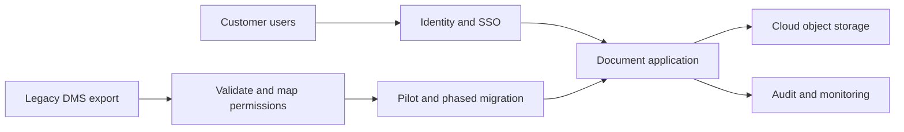

# CloudPath — Cloud Migration Discovery & ROI Dashboard

A **pre-sales / Solutions Engineering portfolio proof of concept** that combines fictional customer discovery, editable cloud cost assumptions, transparent financial modeling, an architecture concept, and a customer-facing demo.


> **Project Note:** This is a Solutions Engineering portfolio prototype using simulated customer data and customizable cloud pricing assumptions. It demonstrates technical discovery, cost modeling, and solution design rather than production cloud infrastructure.

## What it demonstrates
- **Discovery:** translate storage, user count, system limitations, and customer priorities into requirements.
- **Technical translation:** connect a proposed cloud architecture to customer business outcomes.
- **ROI modeling:** compare current monthly cost, proposed recurring cost, one-time migration and contingency, year-one difference and simple payback.
- **Demo and objections:** change assumptions live, reveal when migration is *not* economically favorable, and export a summary.
- **Engineering basics:** Python dataclass-based calculation logic, input validation, unit tests, and a Streamlit UI.

## Run locally
```bash
python3 -m venv .venv
source .venv/bin/activate  # On Windows: .venv\\Scripts\\activate
pip install -r requirements.txt
streamlit run app.py
```
Then open the local address shown in your terminal (commonly http://localhost:8501).

## Test
From the repository root:
```bash
python -m unittest discover -s tests -v
```

## Example scenario (fictional)
A 45-person law firm with 8 TB of storage, $3,000/month in combined legacy storage and administration expenses, proposed storage at **illustrative** $0.023/GB-month, $450/month for administration, $600/month in licenses, and a $7,000 migration estimate plus 15% contingency.

**Do not claim these are real customer outcomes.** A real business case needs provider quotes and migration validation.

## Demo artifacts
- [`docs/DISCOVERY_WORKSHEET.md`](docs/DISCOVERY_WORKSHEET.md) — customer discovery, tradeoffs and pilot criteria.
- [`docs/DEMO_SCRIPT.md`](docs/DEMO_SCRIPT.md) — five-minute mock customer walkthrough.
- `app.py` — dashboard; `estimator.py` — independently testable financial model.

## Architecture concept

This is a **conceptual** design. It does not implement secure upload, DMS integration, encryption, policy enforcement, or infrastructure deployment.

## Real-world checks before use
Check data residency, encryption and key management, legal hold and retention, user permissions, recovery objectives, versioning, access logging, backup and lifecycle policies, API compatibility, storage operations, data transfer/egress, licensing, and support fees. Use the relevant cloud vendor's official pricing calculator for up-to-date estimates.

## Suggested next iteration
Implement an **actual** AWS sandbox proof of concept with S3, IAM least-privilege controls, Lambda/API Gateway, a synthetic dataset, and architecture/IaC documentation. Keep it separate from this financial model until it is built and tested.
